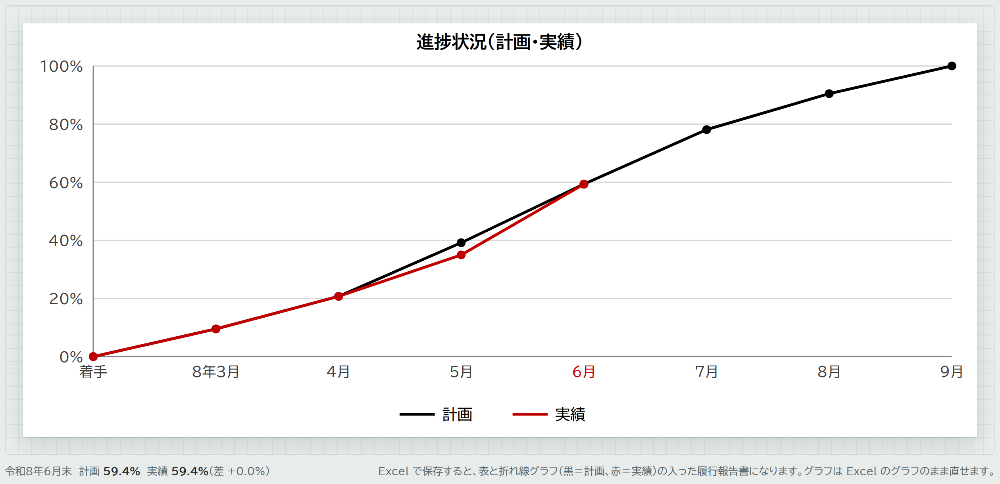

# フローチャート・工程表作成ツール

手順を書くとフローチャートができ、同じ手順から工程表と履行報告書も作れるツールです。
マクロを使わないので、会社の PC でマクロが止められていても使えます。

- **フローチャート** → PowerPoint（.pptx）で保存。四角や矢印は図形のまま直せます
- **工程表** → Excel（.xlsx、第２号様式）で保存。バーは図形のまま直せます
- **履行報告書・業務履行報告書** → Excel（.xlsx）で保存。月ごとの進捗率（日数の割合）と、計画（黒の点線）・実績（赤）の折れ線グラフ付き


## ダウンロード

[リリースのページ](https://github.com/yamamotowt08/flowchart-koutei-tool/releases/latest) から、どちらかを使います。

| ファイル | 中身 |
|---|---|
| **FlowKouteiTool.zip** | アプリ（`フローチャート・工程表作成ツール.exe`）と操作説明書（Word）。ZIP を展開して EXE をダブルクリック |
| **FlowKouteiTool.html** | HTML 版。ダブルクリックして Edge か Chrome で開く。EXE のダウンロードが止められるパソコンでも使えます（できることは同じ） |
| **FlowKouteiTool_FlowPlanOnly.zip** | フローチャートと工程表だけの版のアプリ（`フローチャート・工程表作成ツール（フロー・工程表のみ）.exe`、履行報告書のタブなし）と操作説明書 |
| **FlowKouteiTool_FlowPlanOnly.html** | フローチャートと工程表だけの HTML 版（履行報告書のタブなし）。フローチャート・工程表の機能は上と同じです |
| **FlowKouteiTool_manual.docx** | 操作説明書（Word）。動作環境、画面構成、入力の書き方、各機能の操作、よくある質問 |

EXE は Windows 10・11 に入っている .NET Framework 4.8 と「Microsoft Edge WebView2 ランタイム」で動きます。

## できること

**フローチャート**
- 作業を 1 行に 1 つ書くと、黄色い箱の図ができる（`・` で始めると箱の中の小項目）
- `@照査、打合せ` で照査・打合せを横に分ける（名前が照査・打合せ・第1回打合せ・課長照査・社内照査・現地打合せなどは自動で分かれる。「耐震性能照査検討」や「機場本体の照査」「安定照査」はふつうの作業）。小項目の間に置いた枝分かれは、その間から 1 つだけ分かれ、下の小項目は黄色の箱に残る
- `< 作業 > 合流先` で、左に分かれて進む並行の作業
- `@名前` で、名前を自由に決めた枝分かれ（番号①②は、名前が「照査」「打合せ」だけのものに付く）。`@<名前` で左に分かれる。図の上で反対側へドラッグしても左右が入れ替わる
- 箱・黒い点・線をドラッグして直すと、手順の欄も一緒に変わる。線はまっすぐのまま
- 箱をクリックして、箱ごとに塗りと文字の色を変える（変更・追加した所の文字を赤にするなど。黄色の箱・小項目・照査打合せを 1 つずつ。標準に戻せる）
- PowerPoint で保存、画像をコピー

**工程表**
- 作った工程表の Excel（.xlsx・.xlsm・古い .xls）・PDF から読み込む（「作業項目・開始日・終了日」の表、または月の見出しと線・バーの工程表。このツールで保存した工程表、手で作った業務工程表、工程表自動作成ツール.xlsm の「入力」シート、それらを PDF にしたもの、業務履行報告書の PDF の業務工程表）
- フローチャートの手順を取り込む。行ごとに「作業（黄色の箱）」「小項目」「枝分かれ（右）」「枝分かれ（左）」（名前は自由）を選べる
- 開始日・終了日を入れると日数が自動で入る（暦日／土日祝除く、祝日は自動）
- 「＋期間」で 2 回目・3 回目の期間、「実績」で計画とちがった日付（上段＝計画、下段＝実績の 2 段のバー）
- 行ごとに「文字色」で、作業項目・日数・備考の文字の色を変えられる（変更・追加した所を赤にするなど）。履行報告書の業務工程表・作業項目ごとの進捗にもそのまま出て、「フローチャートに反映」でフローチャートの箱の文字の色にもなる
- 行をドラッグして差し込み・並べ替え（番号も自動で付け直す）
- Excel（第２号様式）で保存

**履行報告書・業務履行報告書**
- 工程表の日付から、月末ごとの進捗率を日数の割合で計算（重み＝計画の日数。工程表の計画の日付・実績の日付で経過の割合）
- 表とグラフは着手時の 0% から始まる
- 業務履行報告書は画面でも業務工程表（黒＝計画、赤＝実績）を確かめられる
- 業務履行報告書は提出用の形式（1 枚目：月別の予定工程％・実施工程％・備考・記事欄・確認欄、2 枚目：業務工程表（計画＝黒、実績＝赤）と作業進捗率のグラフ）
- 画面の「報告の内容」は、提出する様式と同じ形の 1 つの表（業務名・工期・日付、月ごとの予定工程・実施工程・備考、記事欄）
- 実績の値は月ごとに手で置き換えられる
- 月ごとの備考・記事欄（履行報告書は今月の実施内容・来月の予定・備考）の文字の色を変えられる
- 今月の実施内容・来月の予定は、工程表の作業名から自動で文案
- Excel で保存（表と Excel の折れ線グラフ。黒の点線＝計画、赤＝実績）
- 工程表の「作業と日程」の「履行報告書に反映」で、工程表の作業と日付から作り直して履行報告書のタブを開く（いつも工程表から作るので、タブを開くだけでも同じ）



**両方**
- 工程表から「フローチャートに反映」：名前の変更・追加・削除、開始日の順に並べ替え、期間が重なる作業は並行（左）に分ける。作業の番号（1. 2.）を付けるか選べる（小項目はフローチャートの (1)(2)）
- 照査・打合せなどの枝分かれの行には番号を付けず、ほかの作業の番号もずらさない
- 「入力を保存」「入力を開く」で、続きから使える


## 工程表の決まり（工程表自動作成ツール.xlsm と同じ）

- 開始日＋終了日 → 日数を計算／開始日＋日数 → 終了日を計算／終了日＋日数 → 開始日を計算
- 日数だけ → 上の作業の翌日から
- 「＋期間」の行（作業項目が空）→ 上の作業に別の期間のバーを足す
- 「実績」に日付を入れると、その作業は上段に計画、下段に実績のバー
- 日数の数え方は「暦日」か「土日祝除く」。祝日は毎年自動で計算します。年末年始などは「ほかの休み」に入れます

## 作り直し

元は `web/app.html` です。

```
python3 tools/build_web.py      # HTML 版・フロー・工程表だけの HTML 版（と EXE に入れる app/tool.html）を作り直す（python-pptx が必要。PDF を読む pdf.js は tools/vendor/pdfjs から入る）
python3 tools/build_app.py      # EXE と dist/FlowKouteiTool.zip、フロー・工程表だけの版の EXE と dist/FlowKouteiTool_FlowPlanOnly.zip を作る（dotnet が必要）
python3 tools/make_shots.py     # 操作説明書の絵を docs/img/ に作る（Google Chrome が必要）
python3 tools/build_manual.py   # 操作説明書 docs/…_操作説明書.docx を作る（python-docx が必要）
```
