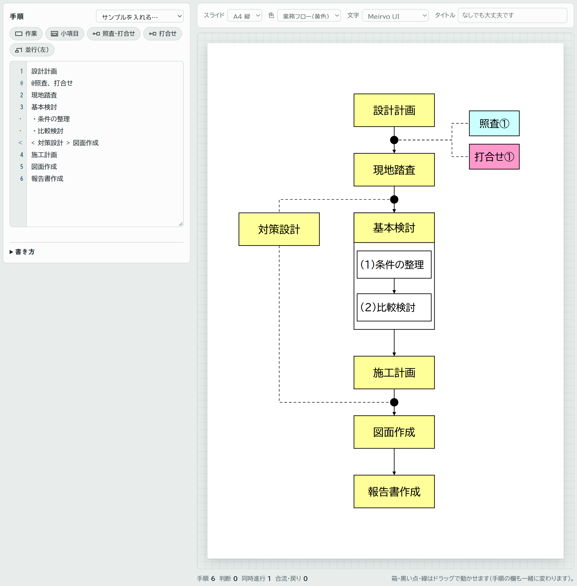
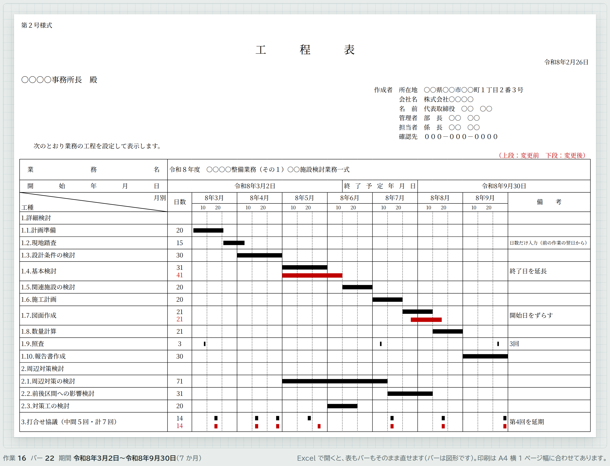

# フローチャート・工程表作成ツール

手順を書くとフローチャートができ、同じ手順から工程表も作れるツールです。
マクロを使わないので、会社の PC でマクロが止められていても使えます。

- **フローチャート** → PowerPoint（.pptx）で保存。四角や矢印は図形のまま直せます
- **工程表** → Excel（.xlsx、第２号様式）で保存。バーは図形のまま直せます



## ダウンロード

[リリースのページ](https://github.com/yamamotowt08/flowchart-koutei-tool/releases/latest) から、どちらかを使います。

| ファイル | 中身 |
|---|---|
| **FlowKouteiTool.zip** | アプリ（`フローチャート・工程表作成ツール.exe`）と、つかいかたブック（Word・PDF）。ZIP を展開して EXE をダブルクリック |
| **フローチャート・工程表作成ツール.html** | HTML 版。ダブルクリックして Edge か Chrome で開く。EXE のダウンロードが止められるパソコンでも使えます（できることは同じ） |
| **つかいかたブック（.docx / .pdf）** | 小学生でもわかる言葉で書いた、できることリストと手順書 |

EXE は Windows 10・11 に入っている .NET Framework 4.8 と「Microsoft Edge WebView2 ランタイム」で動きます。

## できること

**フローチャート**
- 作業を 1 行に 1 つ書くと、黄色い箱の図ができる（`・` で始めると箱の中の小項目）
- `@照査、打合せ` で照査・打合せを横に分ける（名前に照査・打合せが入っていれば自動で分かれる）
- `< 作業 > 合流先` で、左に分かれて進む並行の作業
- 箱・黒い点・線をドラッグして直すと、手順の欄も一緒に変わる。線はまっすぐのまま
- PowerPoint で保存、画像をコピー

**工程表**
- フローチャートの手順を取り込む。行ごとに「作業（黄色の箱）」か「小項目」かを選べる
- 開始日・終了日を入れると日数が自動で入る（暦日／土日祝除く、祝日は自動）
- 「＋期間」で 2 回目・3 回目の期間、「変更後」で変わった日付（上下 2 段のバー）
- 行をドラッグして差し込み・並べ替え（番号も自動で付け直す）
- Excel（第２号様式）で保存

**両方**
- 工程表から「フローチャートに反映」：名前の変更・追加・削除、開始日の順に並べ替え、期間が重なる作業は並行（左）に分ける
- 「入力を保存」「入力を開く」で、続きから使える



## 工程表の決まり（工程表自動作成ツール.xlsm と同じ）

- 開始日＋終了日 → 日数を計算／開始日＋日数 → 終了日を計算／終了日＋日数 → 開始日を計算
- 日数だけ → 上の作業の翌日から
- 「＋期間」の行（作業項目が空）→ 上の作業に別の期間のバーを足す
- 「変更後」に日付を入れると、その作業は上段に変更前、下段に変更後のバー
- 日数の数え方は「暦日」か「土日祝除く」。祝日は毎年自動で計算します。年末年始などは「ほかの休み」に入れます

## 作り直し

元は `web/app.html` です。

```
python3 tools/build_web.py      # HTML 版（と EXE に入れる app/tool.html）を作り直す（python-pptx が必要）
python3 tools/build_app.py      # EXE と dist/FlowKouteiTool.zip を作る（dotnet が必要）
python3 tools/make_shots.py     # 手順書の絵を docs/img/ に作る（Google Chrome が必要）
python3 tools/build_manual.py   # 手順書 docs/…_つかいかた.docx と PDF を作る（python-docx・LibreOffice が必要）
```
